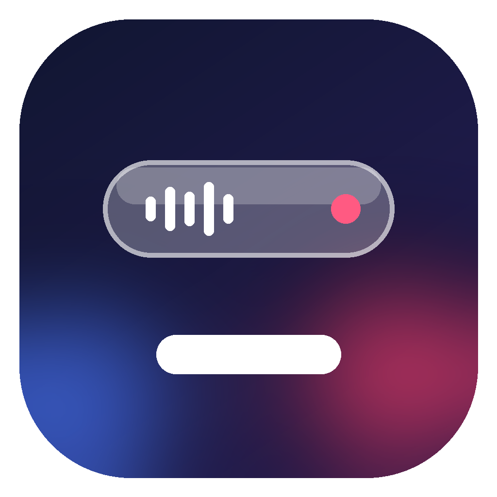
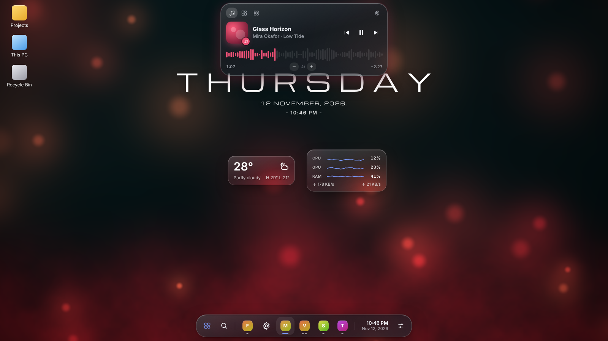
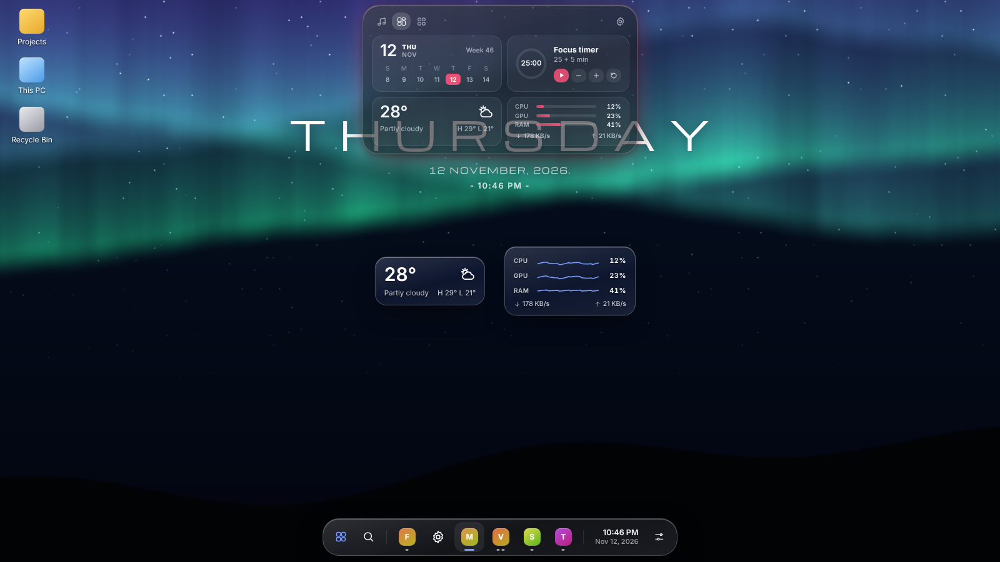
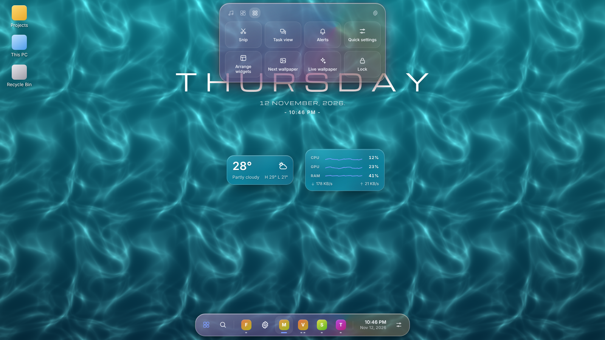
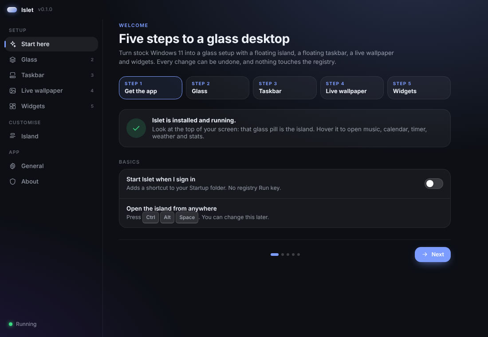
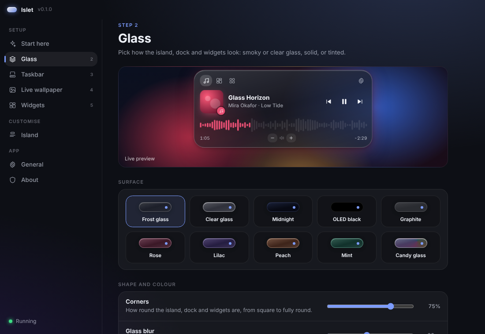

<div align="center">



# Islet

**Turn a stock Windows 11 desktop into a glass setup in five quick steps.**
A floating island, a floating taskbar, a live wallpaper and desktop widgets.
No Rainmeter, no registry edits, no cost.

Created and maintained by **[Mohammed Anas Asif](https://github.com/MohammedAnasAsif)**.



</div>

## The five steps

| Step | What you get |
| --- | --- |
| **1. Get the app** | Download the installer or the portable zip from [Releases](../../releases). Islet starts in the tray and opens a short setup guide. |
| **2. Glass** | Pick a surface: Frost glass, Clear glass, Midnight, OLED black, Graphite, Rose, Lilac, Peach, Mint or Candy glass. Then set the corner roundness and accent colour (it can follow your album art). |
| **3. Taskbar** | Keep the Windows taskbar, **float** it (your real taskbar, inset with rounded corners) or switch to the **Islet glass dock**. |
| **4. Live wallpaper** | Four built-in animated scenes (Silk, Aurora, Ember, Lagoon), or your own MP4/WebM videos, GIFs and pictures, playing behind your desktop icons. |
| **5. Widgets** | A big spaced-out clock, weather, CPU/GPU/RAM/network, a calendar and now playing. Drag them into place and resize them. |

<table>
<tr>
<td></td>
<td></td>
</tr>
<tr>
<td></td>
<td></td>
</tr>
</table>

## What's inside

**The island.** A glass pill at the top of the screen. When it's closed it shows the time, the song that's playing or your focus timer. Hover it (or press <kbd>Ctrl</kbd>+<kbd>Alt</kbd>+<kbd>Space</kbd>) and it opens into three cards:
- **Music:** album art, title, artist, play/pause, skip, a scrubbable waveform and volume. It works with any player that appears in Windows' volume flyout, such as Spotify, YouTube in Edge or Chrome, and Media Player.
- **Overview:** this week's calendar, a focus timer (pomodoro), the weather and live CPU/GPU/RAM/network.
- **Quick actions:** Snip, Task view, notifications, Quick settings, Arrange widgets, Next wallpaper, Live wallpaper on/off and Lock.

When a window is maximised, the island slims down to a thin strip so it never covers browser tabs. It hides completely in fullscreen games and videos.

**Floating taskbar.** This reshapes the real Windows taskbar into a rounded bar inset from the screen edges, so every button, the tray and the clock keep working. You can set the margins, the radius and the width.

**Glass dock.** A centred glass dock with Start, Search, your pinned apps, running apps (with real icons and window indicators), a clock and Quick settings. Right-click an app to pin it, unpin it, open a new window or close it. Maximised windows stop above the dock.

**Live wallpaper.** It renders behind your desktop icons and pauses on its own when an app is maximised or fullscreen, or when you're on battery. You can set the frame rate and render quality.

**Real glass widgets.** The widgets are drawn inside the wallpaper layer, so their frosted glass actually blurs and saturates the moving wallpaper behind them. When the live wallpaper is off, they sit on your normal Windows wallpaper.

## Safe by design

- **No registry edits.** Settings live in one JSON file in `%APPDATA%\Islet`. "Start when I sign in" adds a shortcut to your Startup folder, not a Run key.
- **Nothing injected into Explorer.** Islet only uses public Windows APIs: a window region for the floating taskbar, the official AppBar auto-hide setting for the dock, and the desktop's wallpaper layer for the live wallpaper.
- **Everything is undone on quit.** If Islet ever crashes with the taskbar changed, the next launch puts it back. You can also use **Restore Windows taskbar** in the tray menu, or run:
  ```
  Islet.exe --restore
  ```
- **No accounts, ads or telemetry.** The only network request is the weather forecast from [Open-Meteo](https://open-meteo.com) (free, no key), and only after you choose a city.

## Install

1. Go to [Releases](../../releases) and download **`Islet-Setup-x.y.z-x64.exe`**. It's a per-user install with no admin needed. For a portable, zero-install version, download **`Islet-x.y.z-win-x64-portable.zip`** instead.
2. Run it. If Windows SmartScreen says "Windows protected your PC", click **More info → Run anyway**. That warning shows up for any new app that isn't code-signed yet (see [Roadmap](#roadmap)).
3. Follow the five steps.

You need Windows 11 (22H2 or later recommended). Windows 10 mostly works too, but without the Acrylic settings window. Windows on ARM runs the x64 build.

## Build from source

You need [Node.js 22](https://nodejs.org) and Git.

```bash
git clone https://github.com/MohammedAnasAsif/Islet.git
cd Islet
npm install
npm start          # run Islet (Windows for the full experience)
npm run dist       # build the installer + portable zip into dist/
```

You can work on the UI on macOS or Linux too. The native layer switches itself off, and every page runs with sample data:

```bash
npm run preview -- --serve        # open http://localhost:5179/settings/index.html
npm run preview                   # or render every screen to docs/screenshots
```

`npm test` runs the unit tests, and `npm run lint` syntax-checks everything. On Windows, `npm run smoke:win` checks the Win32 layer read-only.

## How it works

| Piece | Technique |
| --- | --- |
| App shell | [Electron](https://www.electronjs.org), plain JavaScript, no build step |
| Win32 calls | [koffi](https://koffi.dev) FFI, a prebuilt binary, so no C++ toolchain is needed |
| Live wallpaper | Reparents a window into the desktop's `WorkerW` layer behind the icons, supporting both the classic layout and the Windows 11 24H2+ `Progman` layout |
| Floating taskbar | `SetWindowRgn` with a rounded region on `Shell_TrayWnd`, re-applied if Explorer restarts |
| Glass dock | `SHAppBarMessage` auto-hide for the Windows taskbar, plus Islet's own AppBar to reserve space |
| Now playing | Windows' `GlobalSystemMediaTransportControls` through a small PowerShell helper (built into Windows) |
| Settings window | Electron's `backgroundMaterial: 'acrylic'` (Windows 11 22H2+) |
| Scenes | WebGL fragment shaders, rendered at reduced resolution with an FPS cap |
| Weather | Open-Meteo forecast and geocoding APIs |

Project layout:

```
src/main/        Electron main process: windows, tray, settings, IPC
src/main/native/ Win32 layer (wallpaper layer, taskbar, window list)
src/main/helpers PowerShell helper for media, GPU and network
src/preload/     The small allow-listed bridge the UI talks through
src/renderer/    UI: island/, dock/, wallpaper/ (scenes + widgets), settings/
scripts/         Preview renderer, syntax check, Windows smoke test
```

## Known limits

- The island uses a tinted glass rather than a live blur, because web content can't blur the screen behind a window that floats over other apps. The widgets and the Settings window get real blur.
- Windows feature updates sometimes change the taskbar or desktop internals. If something breaks after an update, please [open an issue](../../issues/new/choose) with your build number from `winver`.
- In the dock, Microsoft Store apps can show a letter badge instead of their icon.
- The live wallpaper and widgets currently show on the primary monitor only.

## Roadmap

- Multi-monitor wallpaper and widgets
- Code signing through [SignPath Foundation](https://signpath.org) (free for open source) to remove the SmartScreen warning
- A `winget install Islet` manifest
- More scenes, plus web (HTML) wallpapers and community widget packs

## Contributing

Pull requests are welcome. See [CONTRIBUTING.md](CONTRIBUTING.md). Good first issues are new scenes (a single shader in `src/renderer/wallpaper/scenes.js`), new glass surfaces (a block of CSS variables in `src/renderer/shared/theme.css`) and new widgets (`src/renderer/wallpaper/widgets.js`).

## Maintainer

Islet was created by and is owned and maintained by **[Mohammed Anas Asif](https://github.com/MohammedAnasAsif)** ([@MohammedAnasAsif](https://github.com/MohammedAnasAsif)). Questions, ideas and bug reports are welcome in [Issues](../../issues).

## Credits

Islet is an independent open-source project. It isn't affiliated with Microsoft, and it isn't affiliated with any commercial desktop app.

- Weather data by [Open-Meteo](https://open-meteo.com) (CC BY 4.0)
- [Michroma](https://github.com/googlefonts/Michroma-font) font (SIL OFL 1.1)
- [Electron](https://www.electronjs.org) and [koffi](https://koffi.dev) (MIT)

Licensed under the [MIT License](LICENSE).
